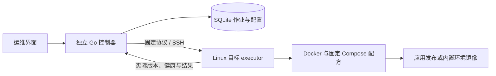

# StreamFusion Ops

独立的 Linux 运维控制器。当前包含 OPS-I01 底座及开发中的 I02 单实例发布链；I02 工程验证和负责人验收分别记录。控制器运行时只需要一个Go二进制。应用发布目标需要已有Docker Engine和Compose；Java由固定镜像提供。

## 构建与运行

开发构建需要 Go 1.26.5、Node 24、pnpm 10.28.0。构建入口会先构建网页，再嵌入 Go 程序；不要直接构建未生成网页的检出目录。

在Windows开发机可执行 `powershell -ExecutionPolicy Bypass -File scripts/build-linux.ps1`，只生成Linux amd64发行包，不安装Windows服务。Linux开发机执行下面的Bash构建入口。二进制运行不需要这些开发工具。

```bash
cd operations
bash scripts/build-linux.sh
./release/0.2.0/streamfusion-ops init-admin --state ./state --username admin
./release/0.2.0/streamfusion-ops serve --state ./state --listen 127.0.0.1:19090
```

管理员密码在本机终端隐藏输入，长度6–64字节且包含英文字母和数字。非交互初始化可使用权限0600的临时密码文件（`--password-file`），不用命令参数传递密码。已有管理员时拒绝再次初始化。

Windows 本机开发运行可在 `operations` 目录执行：

```powershell
pnpm --dir web install --frozen-lockfile
pnpm --dir web build
node scripts/embed-web.mjs
go build -trimpath -o streamfusion-ops.exe ./cmd/streamfusion-ops
.\streamfusion-ops.exe init-admin --state .\state --username admin
.\streamfusion-ops.exe serve --state .\state --listen 127.0.0.1:19090
```

已有管理员时跳过 `init-admin`。Windows 仅提供开发运行，不提供服务安装。

前台运行可在启动终端按 `Ctrl+C` 正常退出。也可在另一个终端关闭使用同一状态目录的控制器：

```powershell
.\streamfusion-ops.exe stop --state .\state
```

`stop` 等待状态锁释放后才返回，默认最多等待15秒，可用 `--timeout 30s` 调整。关闭后可以重新执行 `serve`。该命令不删除账号、配置、凭据或状态库；重复关闭返回“控制器已停止”。运行中的发布若因退出失去确认，重启后按原作业核对，不自动重发。

Linux 手动运行同样使用 `./streamfusion-ops stop --state /实际状态目录`；systemd 安装则执行 `sudo systemctl stop streamfusion-ops`，自定义名称替换为对应服务名，避免服务管理器按重启策略再次启动。

默认只监听回环。远程访问可使用 `ssh -L 19090:127.0.0.1:19090 user@server`，然后打开本地19090。指定非回环IP时需要 `--tls-cert` 和 `--tls-key`；不接受通配监听或转发头。

## Linux 安装

面向 Ubuntu 24.04 / systemd / amd64。安装命令和预检详见脚本的 `--help`。未安装任何全局语言环境，也不触碰业务服务。

```bash
# 在可信构建环境取得SHA-256；不要使用不可信来源提供的摘要。
HASH=$(sha256sum release/0.2.0/streamfusion-ops | cut -d' ' -f1)
bash scripts/install-linux.sh --binary release/0.2.0/streamfusion-ops --sha256 "$HASH"
sudo bash scripts/install-linux.sh --binary release/0.2.0/streamfusion-ops --sha256 "$HASH" --apply
```

第一条安装命令只展示计划，第二条执行同一计划并在本机初始化管理员。可指定 `--prefix`、`--state`、`--port`；路径须为不含空格的规范绝对路径。需要 systemd、curl、sha256sum、useradd、runuser 等系统工具。卸载执行 `sudo bash scripts/uninstall-linux.sh --prefix /opt/streamfusion-ops --apply`，保留状态和服务账号。

发行包只含二进制、SHA256SUMS、安装/卸载脚本和说明。将包传到Linux目标后解包，在解包目录执行 `sha256sum -c SHA256SUMS`；文件内摘要须先与可信发行渠道核对，再执行 `sudo bash install-linux.sh --binary ./streamfusion-ops --sha256 <可信二进制摘要> --apply`。

## 备份与恢复

在线可在“控制器设置”下载一致性备份。CLI 备份、导出密钥和恢复需要停止控制器，以取得目录锁。

```bash
./streamfusion-ops backup --state ./state --out ./backup.tar.gz
./streamfusion-ops export-key --state ./state --out ./recovery.key
./streamfusion-ops restore --archive ./backup.tar.gz --key ./recovery.key --state ./restored-state
```

备份包含SQLite一致性快照和加密凭据，**不包含主密钥及镜像归档**。镜像缓存和目标发行材料须另行保留；恢复后缺少归档时拒绝发布和回滚。密钥必须单独保管。恢复只能创建不存在的目标目录；摘要、数据库完整性、外键、控制器身份和凭据解密全部通过后才完成。旧会话全部失效。摘要用于检测损坏，不代替来源可信性。

## 代码入口

- `cmd/streamfusion-ops/main.go`：本机命令和HTTP服务生命周期。
- `internal/controller/`：SQLite、认证、凭据、备份、日志、目标、发布作业与内置插件中心，按职责分文件。
- `internal/webui/web.go`：内嵌网页。
- `web/src/`：总览、主机与依赖、实例、制品、发布作业、凭据、审计和设置。
- `scripts/`：构建和Linux安装/卸载。

认证与业务平台独立。匿名会话10分钟；登录会话闲置30分钟、绝对8小时；连续5次失败锁定15分钟；全局每分钟最多60次密码校验。改密清除全部登录会话。写接口检查来源和CSRF；Session Cookie 为HttpOnly / SameSite Strict，HTTPS时开启Secure。日志最多20MiB×5，凭据修订最多500条，会话最多2000条。

## 检查与故障定位

```bash
go test ./...
go vet ./...
cd web && pnpm build
```

构建二进制后，Linux集成验收入口为 `sudo bash scripts/test-linux.sh /absolute/path/to/streamfusion-ops`；它使用唯一的测试单元、账号和目录，并在完成后清理。浏览器验收入口为 `python scripts/test-browser.py --binary ./streamfusion-ops.exe --output ../.run/ops-browser-new`，需要已有 Python/Playwright/Chromium，仅用于开发测试。

看进程日志及状态目录下 `logs/controller.log`。目录锁冲突返回STATE_LOCKED；端口冲突返回LISTEN_FAILED；高版本数据库返回SCHEMA_TOO_NEW；缺少已有凭据密钥返回KEY_MISSING。现行Schema为6；本次只增加制品的可空冻结运行环境快照和作业引用索引。每次增量升级前生成对应 `before-schema-N` 一致性归档，再事务升级，旧迁移摘要保持不变。旧程序拒绝打开高版本数据库；代码回退须用原密钥与对应升级前备份恢复到新目录。

`STATE_LOCKED` 表示该目录仍被进程持有，锁文件存在本身不表示故障，不能通过删除它关闭服务。优先用 `stop --state`；旧版后台实例未提供本地关闭记录时返回 `STOP_UNAVAILABLE`，需核实监听端口、可执行文件和启动参数后关闭对应进程，随后使用新二进制。

## Git提交范围

可以提交整个 `operations/` 中未被忽略的源码、测试、schema.sql、Go依赖清单、前端依赖锁、脚本和说明。运行前先检查 `git status --short --ignored operations`。

禁止提交状态库及WAL、主密钥、凭据材料、密码文件、TLS密钥、日志、备份、安装产物、node_modules、生成网页和IDE配置。不要使用 `git add -f`。

## 当前范围

I02 当前实现本机/SSH Linux目标登记、固定 Java Compose 制品发布和应用回滚；S4另接入预览节点固定配方、维护许可与版本回退，操作见[预览节点维护](preview-nodes.md)，工程验证与负责人验收分开。Docker引擎自动安装、项目组合发布、源码构建及Jenkins尚未实现。I02仍需当前项目后端和真实第二台主机验收。Linux安装范围为Ubuntu24.04/systemd/amd64，Windows仅支持本机开发运行。

插件中心提供内置 Java 17/21 JRE 与 Maven 3.9.11 + JDK 21 的 Docker 镜像环境，按固定摘要和配方预检、安装、校验、核对与卸载。成功返回前验证实际镜像与版本；未知作业保留目标锁。Java 服务可上传可执行 JAR 并选择已就绪的 Java21：只读导出固定基础镜像、离线追加固定 JAR 层，生成同一条不可变制品/Release 链；排队作业和历史制品的真实引用阻止卸载环境。Java17/Maven 不能用作该 JAR 运行环境，完整镜像不提供替换 JRE 选项。未提供任意下载 URL、脚本安装、源码执行或自动安装 Docker。

P2 / UX-OPS-DESIGN-01 本批补齐来源交接、JAR 固定封装、三层依赖检查与安全排队取消，工程实现和负责人验收分开。接口、迁移、复验步骤与本轮真实验证边界见 [Ops 补齐交付说明](ux-ops-implementation.md)。



`0.2.0` 是当前程序内版本。

## I02 发布闭环

目标初始化必须由负责人在 Linux 目标上明确执行，控制器不会通过任意 SSH 命令自动授予 root 或 Docker 权限：

```bash
sudo ./streamfusion-ops target-init \
  --root /opt/streamfusion-ops-target \
  --controller-id <控制器ID> --target-id <目标ID> \
  --docker-binary /usr/bin/docker --docker-socket /var/run/docker.sock
```

目标使用专用连接账号时，先审阅 `scripts/install-target.sh` 的计划，再显式 `--apply` 安装固定sudo策略。脚本不授予任意shell或docker命令。安装为systemd的本机控制器需显式提供 `--controller-unit`：这会为固定executor关闭NoNewPrivileges并增加该受管根写路径；默认控制器安装仍保持NoNewPrivileges=true。SSH目标无需此本机例外。

页面“主机与依赖”登记目标后先执行“核对目标”。“制品”可以导入固定 Docker save 归档，归档必须是单个 `sfops/` 镜像、`linux/amd64`，并填写可信 SHA-256；也可选择“可执行 JAR + 已安装 Java21”，上传最多128MiB的 JAR。导入完成后在“应用实例”保存 Java 配置草稿，再执行发布预检。每个发布作业都冻结制品、端口、配置、依赖凭据修订、健康路径、数据兼容标识，以及 JAR 制品可选的运行环境身份。

依赖默认仍为外部服务；主机 TCP 检查不证明容器网络或密码可用。选定当前已发布的 Java 实例后，才从其真实容器网络命名空间执行有界 Redis AUTH/SELECT/PING 或 MySQL 握手/COM_PING，使用该 Release 冻结的凭据修订，不建库、不执行 SQL。探针不支持 TLS；MySQL `caching_sha2_password` full-auth 明确返回 `AUTH_TLS_REQUIRED`，不发送明文密码或信任未固定 RSA 公钥。Redis AUTH 仍使用绑定既有的普通 TCP 网络，不能当作加密传输能力。

作业页“取消排队”仅处理未运行、无待 ACK 且非上传中的作业。运行中、`UNKNOWN` 或待 ACK 保留原锁与责任，不提供强杀/强制解锁；取消沿兼容状态 `FAILED / CANCELLED / JOB_CANCELLED` 记录。导入取消确认提交后清理该作业上传的临时文件；清理失败可重试原取消请求，不删除其他制品或运行材料。

作业流程为“目标校验 → 归档校验/导入 → Compose 激活 → 实际容器身份 → 应用健康 → 控制器提交当前/上一成功版本 → 目标确认”。候选健康失败时自动停止候选并按冻结基线恢复；数据库内容不会随应用回滚。`UNKNOWN` 或目标确认未完成时，页面会保留锁并提供“核对/恢复”，不会因为超时自动重放。

源码构建、Jenkins、JDK/Maven/Node/Python 多版本安装、Nginx/MySQL/Redis 受管安装和项目组合发布属于后续工作包。

Linux 隔离发布验收：

```bash
sudo python3 scripts/test-release.py \
  --binary /absolute/path/to/streamfusion-ops \
  --lab /opt/ops-i02-lab \
  --output /tmp/streamfusion-ops-i02-release.json
```

该脚本使用隔离 Docker socket、Java 健康夹具和临时状态，验证 A→B、C 失败恢复、A 回滚、重复提交幂等、日志、实际观察和控制器重启；结果只代表夹具闭环，不代表当前业务后端已上线。
