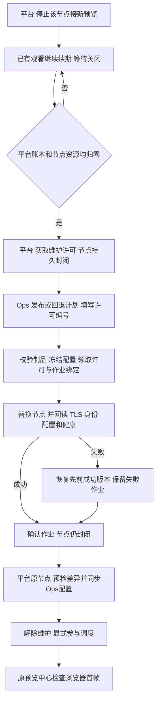

# 通过 Ops 安装和维护预览节点包

本页说明 Ops 如何安装、升级和回退 `preview-node-v1` 节点包。Platform 负责引入实例、来源同步、预览调度和资源回收；自行安装的专用 ZLM 也可由 Platform 接入，无需节点包。现有配方复用 Ops 主机、制品、计划、作业、版本槽位和审计；本机隔离验证不等于独立 Linux A/B 首帧或目标负载验收。UX-OPS-DESIGN-01的实际验证、迁移和未验边界见[本批实施说明](ux-ops-implementation.md)。

本机足够时继续原方式，无须启用 Ops 或添加节点。Ops 负责部署维护；每次预览仍由 Platform 的 S3 调度器决定，媒体直达浏览器。每节点观看/转码默认与上限保持 64，转码 0 禁用，旧 2/8 限制不恢复。

## 首次部署

1. 准备 Ubuntu 24.04/amd64、Docker Engine 和 Compose。在现有 Ops 登记本机或 SSH 目标，按现有目标安装说明准备受保护的 executor。Ops 可登记一台本机及最多 16 台 SSH 目标；控制器和目标 executor 均须支持 `preview-node-v1`。预检未返回该能力时拒绝部署，不会自动更新旧 executor 或安装 Docker。
2. 用同版本 `platform-api/preview-node/build-package.sh` 生成离线包，核对可信 SHA256SUMS。解包后，在“制品”选择“预览节点”，导入 **`preview-node-image.tar`**。不上传整个 `.tar.gz`；上限 2 GiB，镜像须为 `streamfusion/preview-node:*`，具备 `com.streamfusion.preview.maintenance=1`。
3. “服务实例 → 新增实例”选择预览配方及目标，填写唯一 nodeId、实际绑定 IPv4、控制域名/IP、浏览器可达的媒体 IPv4、允许访问的相机 IP:RTSP 端口。高级容量默认 64/64/64/4，可向下校准；CPU/内存按机器配置。
4. 保存草稿、生成发布计划，检查目标、摘要、冻结配置和端口后执行。只公开 9443/TCP、18000/TCP+UDP；不开放 ZLM 管理端口。节点容器不连接业务 MySQL/Redis。
5. 首次对接时，由管理员在 Ops 与 Platform 分别配置内容相同、权限受保护的服务身份令牌文件，并设置 Ops 地址；这是一项平台级连接配置，不需要逐节点填写控制地址或证书指纹。Ops 前台启动使用 `--platform-token-file` 指向私有目录中的 0600 文件；Linux systemd 安装使用 `scripts/install-linux.sh --platform-token-file <0700目录内的0600令牌源文件> --apply`，安装脚本复制到私有状态目录并把目标路径写入服务单元，重复安装须继续传同一令牌。Platform 配置 `SF_PREVIEW_OPS_BASE_URI`、`SF_PREVIEW_OPS_TOKEN_FILE` 和 `SF_PREVIEW_NODE_CREDENTIAL_DIRECTORY`。非回环 Ops 地址必须走 HTTPS，证书须被 Platform 信任。服务身份文件和机器令牌不得进入网页、日志或 Git。
6. Ops 发布成功后，在“监控面板 → 预览节点”选择该服务器上的已部署实例，核对名称、安装位置、发布版本和容量，点击“引入”。Platform 服务端按实例及发布版本从 Ops 安全取得连接元数据和机器令牌，验证节点身份与资源，再将机器令牌写入受保护目录；登记后默认不接新预览。检查预算/优先级并显式启用，到预览中心试播；失败时停止该节点接新预览。旧受保护连接 JSON 导入与手工登记保留在高级入口；普通接入不需要复制 `machine-token` 或手填节点 ID、控制 HTTPS 地址、证书指纹。

首次部署不需要维护许可，因为该 Ops 实例没有旧版本。默认固定端口适合每台媒体机一个节点；A/B 分别重复部署。已有手工节点不会被自动接管，不得用首次部署绕过其排空和责任核对。

Ops实例目录只列已发布的预览配方，服务交接返回controller/target/instance/release稳定来源。旧Ops缺少来源时目录仍可读，但不得据此新绑定。引入时若版本变化、不可达、身份不符、资源未归零或有未决作业/待ACK，应保持原状态。首次引入不覆盖已有节点；升级后使用原节点“同步Ops配置”。旧手工节点须在排空后明确选择来源，不按IP/名称猜配。独立Linux与A/B首帧仍需实机验收。

同一 Ops 实例升级时保持 `nodeId` 稳定。若确需更换身份，Platform 会视为新节点；先排空并核对旧节点，再单独登记新节点，不会自动替换原节点。

## 排空、升级和回退

平台签发前验证超级管理员、节点版本、DRAINING、平台源/输出/观看/启动/带宽全零、无 PENDING/UNKNOWN 操作。节点在同一准入锁内再次核对自身资源并落盘封闭，因此许可签发与新建观看不能穿透竞态。

许可绑定 nodeId、bootId、configVersion。10 分钟是 **Ops 领取期限**，过期不会自动开放新预览。Ops 领取后绑定 jobId；重启保留封闭，作业成功/失败且完成确认后变为“可解除”。平台只能在排空且为空时解除，解除后仍是 DRAINING，需要另外显式启用。已领取的许可不能由平台提前解除。

升级使用新制品及本次冻结配置；回退使用 previous 成功版本及其完整配置，不拿当前草稿拼接旧镜像。失败候选不占用成功版本槽位。nodeId、控制/媒体地址及绑定地址在同一实例内固定，换身份应另行迁移，不在升级表单中修改。

同步要求原三元组、节点版本一致、平台排空且责任归零；网络预检不占SQL事务，应用时再交接复检和CAS。保留平台较低预算、优先级和nodeId，成功仍DRAINING；来源/Release/配置不匹配时不解除/启用。先同步新configVersion，再以当前平台version和原permitId按既有规则解除维护。地址、证书或machineToken轮换不夹带在本操作。启用前重新核对Ops当前Release，但并非跨系统原子事务。

专用ZLM无节点包的持久维护许可；其同步只检查平台账本与全量物理媒体瞬时为空，可消费冻结Release的API凭据修订，不变更地址。维护期间仍须避免外部推流/写入，不能把交接短锁或空闲观察当作持续许可。

## 中断与常见故障

| 现象 | 处理入口 |
|---|---|
| 无维护许可、许可过期/不匹配 | 平台节点页核对版本、排空与资源；解除未领取的旧封闭后重新获取。Ops 在领取成功前不会停止旧节点 |
| 节点为 CLAIMED，作业为 UNKNOWN 或确认待完成 | 在 Ops 原作业“核对”；保留目标锁、jobId 和责任文件，不另开作业或删除锁 |
| 新版本健康失败 | 查看作业阶段与脱敏错误；已领取维护许可时恢复基线并回读。恢复失败保持 UNKNOWN，需要原作业继续核对 |
| 许可持久记录损坏或意外丢失 | 保持封闭/待确认，核对受保护目标文件和备份；不要通过删记录清零 |
| Ops成功但平台配置版本不一致 | 保持排空，在原节点预检→同步Ops配置，核对来源/Release/预算，然后按原许可解除、显式启用；不要重复导入 |
| 平台能检查，浏览器没有首帧 | 分别检查节点 RTSP 白名单、浏览器到媒体 IPv4 的 TCP/UDP、码流和授权；控制健康不等于播放成功 |
| 制品拒绝、executor 不支持预览配方 | 使用同版本维护兼容镜像和目标 executor；旧 S2/S3 镜像不具备持久维护约束，不能作为 Ops 回退版本 |

定位链：平台 traceId/nodeId/permitId → Ops jobId/冻结计划/实际观测 → 目标 `jobs/<jobId>` → 容器日志。实例目录保留 `preview-identity`（稳定凭据）、`preview-state/ownership`（资源与维护责任）及 `releases/<releaseId>/preview-config`（冻结配置）。只读日志接口有界；不记录 Token、完整 RTSP 或 SDP。

## 数据与程序回退

S4历史上增加独立节点维护文件，不改变原资源日志。当前UX-OPS-DESIGN-01另给Platform preview_node增加5个可空来源列，已有库须停机备份后执行定向升级，不能重放初始化；本轮未执行真实库。Ops当前SQLite schema6，新增制品运行环境快照及Job引用索引，旧迁移校验保留。启动前自动一致性备份；程序回滚须停机并以迁移前备份在新目录配套恢复，保留作业证据，不让旧程序打开schema6。

节点程序只回退到可识别同一维护/资源格式的 S4 镜像。原节点身份、责任目录和成功版本材料必须保留；不能用数据库恢复或删除目录代替媒体资源核对。原 S3 手工节点迁移到 Ops 属于显式停机迁移，当前没有自动接管/卸载或批量并行部署按钮。

## 工程复验入口

`go test ./...`、`go vet ./...`、`pnpm --dir web build`。真实节点维护脚本为 `scripts/test-preview.py`：需要独立 `/opt/sf-preview-s4-*` 测试目录、独立 Docker socket、Docker/Compose、A/B 两份维护兼容镜像和坏版本 C 的 Docker save 归档。运行参数见 `--help`；它验证部署、升级、坏版本恢复、回退、控制器中断及原作业核对，不能指向正式目标。

这轮本机隔离结果不代替第二台服务器、真实 SSH/跨网、64 路承载、长稳或负责人认知验收。没有自动迁移已有观看，没有改算法 Node Agent 或 Runtime。
